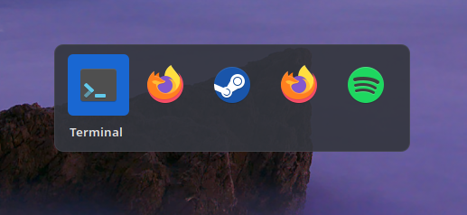

# Budgie Classic Alt-Tab Switcher

The Alt+Tab switcher Budgie had before 10.10, brought back for Budgie's Wayland
session: app icons in centered rows, the selected window's title underneath, most
recently used window first.



## Features

* Centered rows of icons, eight per row
* Opens on the monitor with the focused window
* Matches the labwc titlebar theme, with the GTK accent color for the selection
* Tab / Shift+Tab or arrow keys to move, release Alt, Enter or click to switch, Esc to cancel
* The Alt+Tab binding survives Budgie regenerating labwc's `rc.xml`

The switcher shows windows from every workspace, because labwc doesn't report which
workspace a window is on.

## Install (Solus)

Download the `.eopkg` from the [latest release](https://github.com/kubasama/budgie-classic-alttab-switcher/releases/latest) and install it:

```sh
sudo eopkg it budgie-classic-alttab-switcher-*.eopkg
```

Then turn it on for your user. This also starts it; after that it starts at every login.

```sh
budgie-classic-alttab-switcher enable
```

`enable` adds Alt+Tab, Shift+Alt+Tab and Alt+Esc as Budgie custom shortcuts and takes
them away from the built-in switcher. `disable` puts everything back. Run
`budgie-classic-alttab-switcher disable` **before uninstalling**, or Alt+Tab stays
bound to a program that's no longer there.

Updates aren't automatic: check the Releases page for new versions.

## Commands

```
budgie-classic-alttab-switcher enable    bind Alt+Tab to the switcher and start it
budgie-classic-alttab-switcher disable   give Alt+Tab back to the built-in switcher
budgie-classic-alttab-switcher status    is Alt+Tab bound, is the switcher running
budgie-classic-alttab-switcher list      open windows with their app ID and icon
budgie-classic-alttab-switcher quit      stop the background switcher
```

## Configuration

Optional files in `~/.config/budgie-classic-alttab-switcher/`, applied as soon as
they're saved:

* `icons.conf`: icons for apps that show a generic one, one
  `app-id = icon-name or /path/to/image` per line. `list` shows the app IDs.
* `style.css`: GTK CSS on top of the defaults, for example:

  ```css
  window.budgie-classic-alttab-switcher > box { background-color: rgba(30, 30, 34, 0.75); }
  window.budgie-classic-alttab-switcher .tile.selected { background-color: #5e81ac; }
  ```

## Building from source

Build dependencies: `meson`, `vala`, and the development files for `gtk+-3.0`,
`gtk-layer-shell-0` and `libxfce4windowing-0`.

```sh
meson setup build --prefix=/usr
ninja -C build
sudo ninja -C build install
```

To build an `.eopkg` instead:

```sh
sudo eopkg it solbuild && sudo solbuild init    # one time
./packaging/make-eopkg.sh
```

## License

GPL-2.0-or-later. See [LICENSE](LICENSE).

The design follows the tab switcher that was part of
[Budgie Desktop](https://github.com/BuddiesOfBudgie/budgie-desktop) before 10.10.
This is a separate implementation for Wayland.
